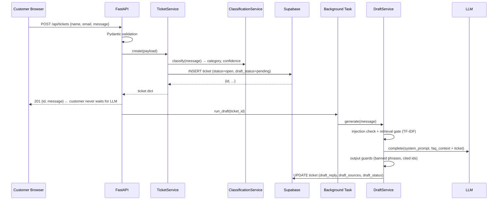
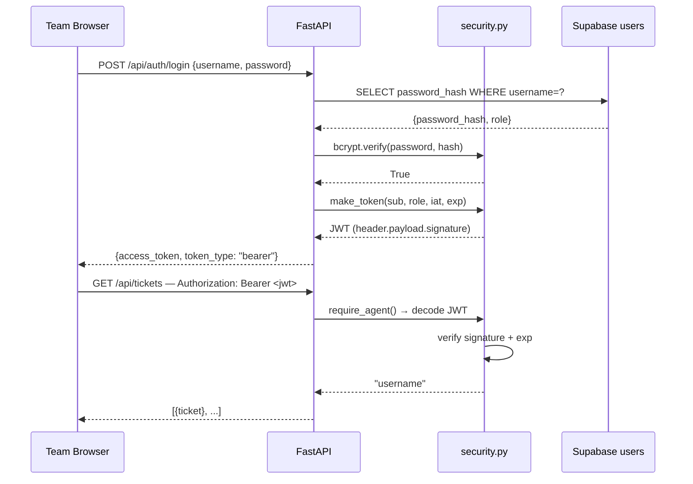

# Architecture — Smart Support Desk

## System Overview

```mermaid
flowchart TD
    subgraph Browser["🌐 Browser (React + Vite + TypeScript)"]
        CP["CustomerPage\n/  (form)"]
        TP["TeamPage\n/team (login + dashboard)"]
    end

    subgraph Backend["⚙️ Backend (FastAPI + Python 3.11+)"]
        subgraph Routes["api/routes.py (HTTP only)"]
            R1["POST /api/tickets"]
            R2["POST /api/auth/login"]
            R3["GET /api/tickets (JWT)"]
            R4["GET /api/tickets/id (JWT)"]
            R5["PATCH /api/tickets/id (JWT)"]
            R6["GET /api/categories (JWT)"]
            R7["GET /health, /api/health"]
        end

        subgraph Services["app/services/"]
            TS["TicketService\n(orchestrates)"]
            CS["ClassificationService\n(UNCLEAR policy)"]
            DS["DraftService\n(retrieval + guards)"]
            PR["priority.py\n(rule-based)"]
        end

        subgraph Security["app/security.py"]
            BCR["bcrypt verify\n(passlib)"]
            JWT["JWT sign/verify\n(PyJWT HS256)"]
            SEED["Startup seed user\n(idempotent)"]
        end

        subgraph Classifiers["app/services/classifier/"]
            CL1["OnnxClassifier\n(default, no torch)"]
            CL2["HFClassifier\n(safetensors)"]
            CL3["JobLibClassifier"]
            CL4["NullClassifier\n(fallback)"]
        end

        subgraph Repo["app/repositories/"]
            SR["SupabaseRepo\n(service-role key)"]
            MR["MemoryRepo\n(tests / dev)"]
        end

        LLM["llm.py\nMock | Ollama | Anthropic"]
        FAQ["FaqRetriever\nTF-IDF char n-grams"]
    end

    subgraph DB["🗄️ Supabase (Postgres)"]
        TBL["tickets table\n(RLS ON, no policies)"]
        UTBL["users table\n(RLS ON, service-role only)"]
    end

    subgraph ML["🧠 ML Pipeline (backend/ml/)"]
        EX["explore.py\ndata audit"]
        TR["train.py\nTF-IDF + LR baseline"]
        DT["colab_train_distilbert.py\nDistilBERT fine-tune"]
        LC["leak_check.py\ngroup-aware split"]
        EM["eval_messy.py\nMessy-20 test set"]
    end

    CP -->|POST /api/tickets| R1
    TP -->|POST /api/auth/login| R2
    TP -->|Bearer JWT| R3
    TP -->|Bearer JWT| R4
    TP -->|Bearer JWT| R5

    R1 --> TS
    R2 --> BCR
    BCR --> UTBL
    R2 --> JWT
    R3 --> TS
    R4 --> TS
    R5 --> TS

    TS --> CS
    TS --> DS
    TS --> PR
    TS --> SR
    CS --> CL1
    CS --> CL2
    CS --> CL3
    CS --> CL4
    DS --> FAQ
    DS --> LLM
    SR --> TBL
    SEED --> UTBL

    DT -->|model.onnx\ntokenizer.json\nlabels.json| CL1
    DT -->|model.safetensors\nconfig.json| CL2
```



## Request Flow — Ticket Creation (POST /api/tickets)



## Request Flow — Team Login + Protected Endpoint



## Security Layers

| Layer | Mechanism |
|-------|-----------|
| Password storage | bcrypt hash via passlib (never plain-text) |
| JWT signing | HS256, secret from `JWT_SECRET` env var |
| JWT payload | `sub`, `role`, `iat`, `exp` only (no secrets) |
| DB access | Supabase service-role key (server-side only); RLS ON with no policies = anon key blocked |
| Draft grounding | Retrieval gate → prompt rules → output guards → human review |
| Injection defence | Regex detection + stripped from retrieval query + flagged in UI |

## Folder Map

```
digital-turtles/
├── frontend/              React + Vite + TypeScript
│   └── src/
│       ├── pages/         CustomerPage, TeamPage
│       ├── components/    TicketTable, TicketDrawer, DraftPanel, Field, Alert, Badges
│       └── lib/           api.ts (fetch wrapper + token storage), types.ts, validation.ts
├── backend/
│   ├── app/
│   │   ├── api/           routes.py (HTTP only), deps.py
│   │   ├── services/      ticket_service, classification_service, draft_service,
│   │   │   │              faq_retriever, llm, priority
│   │   │   └── classifier/ onnx_backend, hf_backend, joblib_backend, factory, base
│   │   ├── repositories/  base (Protocol), supabase_repo, memory_repo
│   │   ├── config.py      pydantic-settings (env vars)
│   │   ├── security.py    bcrypt + JWT
│   │   ├── schemas.py     Pydantic request/response models
│   │   ├── errors.py      unified error format
│   │   ├── container.py   composition root (DI)
│   │   ├── main.py        FastAPI app + startup seed user
│   │   └── textclean.py   shared text normaliser (train ↔ serve)
│   ├── ml/                B1: explore, groups, splits, train, leak_check, eval_messy, colab_train_distilbert
│   ├── eval/              B3: run_eval, tune_threshold, test_tickets.json
│   ├── tests/             pytest (API, auth, classifier, drafts, ML pipeline, priority)
│   ├── data/faq.json      14-entry FAQ (B2 grounding source)
│   ├── models/            model.onnx + tokenizer.json + labels.json (not in repo)
│   └── docs/ai-mistakes.md
├── supabase/schema.sql    tickets + users tables + RLS + trigger
├── docker-compose.yml     one-command startup
├── .env.example           safe template (no real secrets)
└── README.md
```
